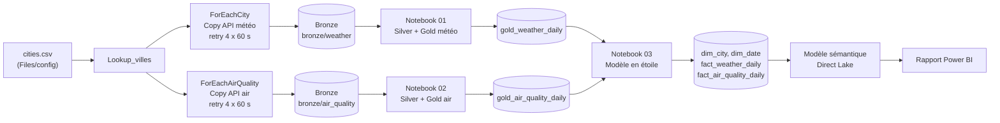

# fabric-medallion-meteo-air-maroc

Pipeline de données **Microsoft Fabric** multi-sources (météo + qualité de l'air) pour 7 villes du Maroc : ingestion horaire d'APIs, architecture médaillon (Bronze / Silver / Gold) sur Delta Lake, modèle en étoile et dashboard Power BI en **Direct Lake**.

Projet réalisé dans le cadre de la formation Big Data & Data Science, ENSA Kénitra. Développé sur une capacité d'essai Fabric.


## Sources de données

| Source | API (Open-Meteo) | Contenu |
|---|---|---|
| Météo | `api.open-meteo.com` (`/v1/forecast`) | Température, humidité, précipitations, vent (horaire) |
| Qualité de l'air | `air-quality-api.open-meteo.com` (`/v1/air-quality`) | PM10, PM2.5, NO2, ozone, indice européen EAQI (horaire) |

> **Les valeurs de qualité de l'air sont modélisées** (prévision Open-Meteo / CAMS). Ce ne sont pas des mesures de stations. Chacune des 7 villes tombe sur une cellule de grille distincte.

Les 7 villes (Kenitra, Rabat, Casablanca, Tanger, Fes, Marrakech, Agadir) sont définies dans [`config/cities.csv`](config/cities.csv). Ajouter une ville = ajouter une ligne, sans modifier le pipeline (la liste est lue par une activité Lookup).

## Architecture



Les deux branches (météo et air) sont **indépendantes** : si l'API air est en panne, la branche météo continue. Le notebook du modèle en étoile attend la réussite des deux.


## Couches de données

**Bronze** : JSON bruts, un fichier par ville et par run, nommés `Ville_aaaammjjhhmm.json` (horodatage UTC).

**Silver** :
- traitement **incrémental** : un point de reprise est lu dans le journal qualité (`max_file_ts`), seuls les nouveaux fichiers sont traités ;
- `MERGE` Delta conditionnel : une ligne existante n'est mise à jour que si le fichier source est plus récent ;
- contrôle de complétude (les 7 villes sont-elles présentes ?) ;
- **journal qualité** par source (`silver_quality_log`, `silver_air_quality_log`) ;
- pour l'air, les prévisions se recouvrent d'un run à l'autre : déduplication sur `(city, time)` (fichier le plus récent gagne), et les heures entièrement vides (fin d'horizon de prévision) sont comptées à part comme « hors horizon », pas comme des rejets.

**Gold** : agrégats journaliers par ville.
- `gold_weather_daily` : température (moyenne, max, min), humidité moyenne, précipitations totales, vent max.
- `gold_air_quality_daily` : moyennes journalières PM10, PM2.5, NO2, ozone, AQI (moyen et max), et `nb_heures` pour repérer les jours incomplets.

**Modèle en étoile** (clés de substitution) :

| Table | Grain |
|---|---|
| `dim_city` | 1 ligne par ville (`city_key`) |
| `dim_date` | 1 ligne par jour (`date_key` en `yyyyMMdd`) |
| `fact_weather_daily` | ville × jour |
| `fact_air_quality_daily` | ville × jour |

Les deux faits partagent les mêmes dimensions : un seul filtre ville / période pilote la météo et l'air. Le notebook vérifie à chaque run l'absence d'orphelins et de doublons sur le grain.


## Dashboard

Modèle sémantique en **Direct Lake** sur les tables Delta du Lakehouse, rapport Power BI : cartes (température moyenne, pluie moyenne par jour, vent maximum), courbes de température et d'AQI par ville, barres de pluie cumulée et de PM10 par ville, filtres ville et période.

## Structure du dépôt

```
.
├── README.md
├── config/cities.csv                 # liste des villes (à placer dans Files/config)
├── notebooks/
│   ├── 01_silver_gold_meteo.ipynb
│   ├── 02_silver_gold_air.ipynb
│   ├── 03_star_model.ipynb
│   └── 04_demo_spark.ipynb           # démonstration Spark / Delta (historique, time travel)
├── pipeline/pl_ingest_meteo.json     # définition du pipeline (identifiants remplacés par des placeholders)
└── docs/img/                         # captures
```

## Reproduire

1. Créer un workspace Fabric (capacité d'essai ou payante) et un Lakehouse `lh_meteo`.
2. Importer `config/cities.csv` dans `Files/config` du Lakehouse.
3. Créer deux connexions HTTP anonymes : `https://api.open-meteo.com` et `https://air-quality-api.open-meteo.com`.
4. Importer les notebooks 01 à 03 et attacher `lh_meteo` comme Lakehouse par défaut de chacun.
5. Recréer le pipeline `pl_ingest_meteo` en suivant [`pipeline/pl_ingest_meteo.json`](pipeline/pl_ingest_meteo.json) (les valeurs `<...>` sont des placeholders à remplacer par vos identifiants), puis ajouter un Schedule horaire.
6. Lancer le pipeline, puis créer le modèle sémantique en Direct Lake sur les tables `dim_*` et `fact_*` (relations plusieurs-vers-un des faits vers les dimensions) et le rapport.

## Limites

- Qualité de l'air : valeurs **modélisées**, pas des mesures de terrain.
- Le code est versionné sur GitHub **manuellement** : l'intégration Git de Fabric n'est pas utilisée.
- Pas de tests automatisés : la validité est contrôlée par les contrôles intégrés (complétude, doublons, orphelins) et le journal qualité.
- Dépendance à une seule source d'API (Open-Meteo), avec retry mais sans source de secours.
- Le Gold et le modèle en étoile sont recalculés en entier à chaque run (volumes faibles).

## Pistes d'évolution

- Un notebook Silver générique piloté par un fichier de configuration (`sources.json`) pour ajouter une source sans dupliquer le code.
- Change Data Feed Delta pour propager seulement les changements vers le modèle en étoile.
- Page « Qualité » dans le dashboard à partir des journaux qualité.
